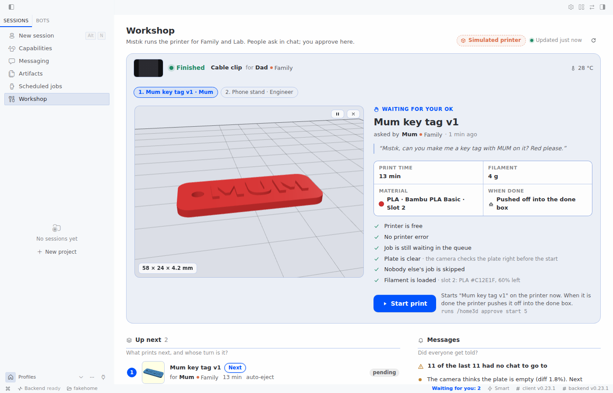
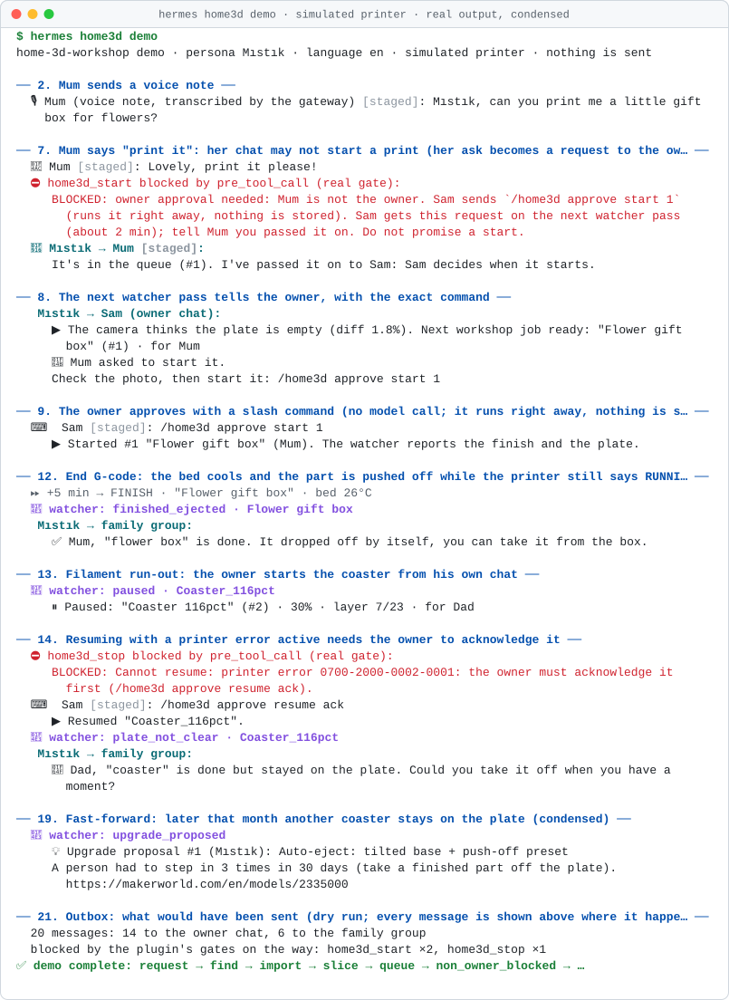
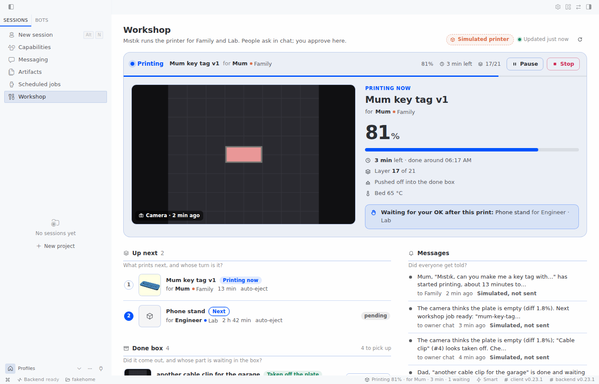
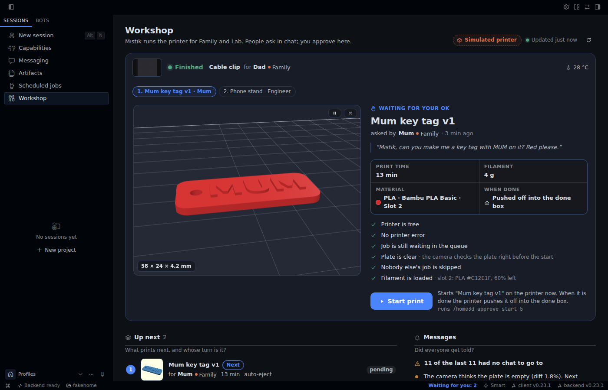
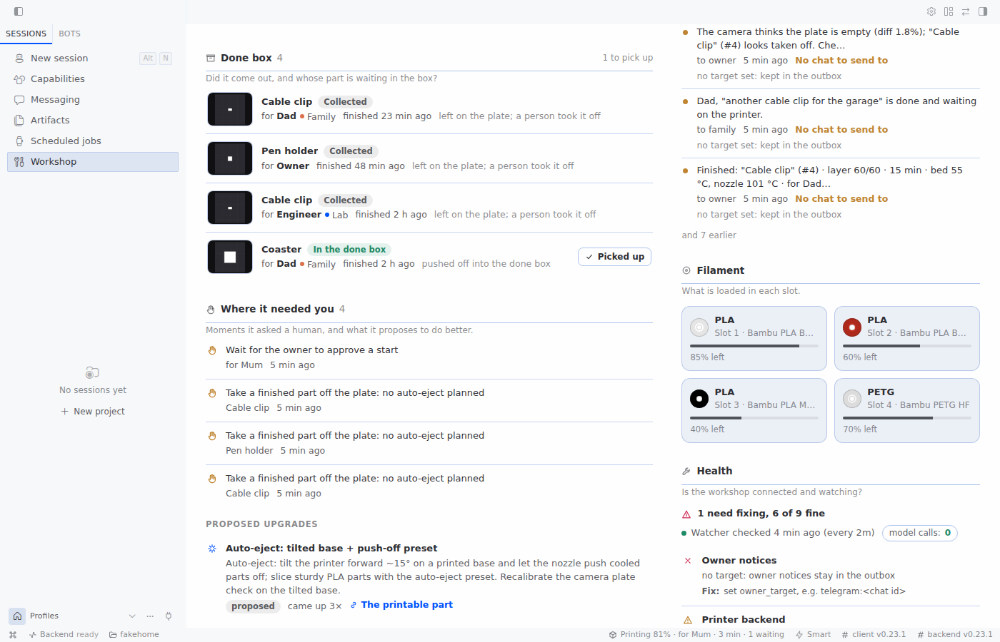

# home-3d-workshop

[](https://github.com/Wijt/hermes-home-3d-workshop/actions/workflows/ci.yml)

**Ask. It's in the box.**

A Hermes Agent plugin that makes a 3D printer a member of the group chat.

A family shares one 3D printer through one group chat. In that chat lives an agent they call Mıstık. The
owner's mother has never opened a slicer. She sends a voice note. The agent finds or designs the part and
shows her a picture. The owner approves the start, typed. A watcher that makes no model calls follows the
print. The part is pushed off the tilted bed into a "done box", and the person who asked gets a message
with a photo, in their own chat. Nobody touches the printer.

The same plugin serves any group: a family at home, or a team in a lab. People who ask never see a screen.
The owner gets one screen in Hermes Desktop, **Workshop**.



## Quick start (simulated printer)

```bash
hermes plugins install Wijt/hermes-home-3d-workshop --enable
hermes home3d demo
```

The demo runs the whole loop on a simulated printer in a temporary folder, in about 10 seconds. It sends
nothing. Keep `--enable`. Without it, Hermes asks whether to enable the plugin (the default is no), and
`hermes home3d` is not found until the plugin is enabled.



To see the Workshop screen, turn on the plugin's Desktop half in Hermes Desktop: **Capabilities →
Plugins**. It is off until you turn it on. Then open **Workshop** in the sidebar (or "Workshop: open the
printer room" in the command palette). On the simulator the screen says "Simulated printer". Ask the agent
in a chat to print a coaster; when the agent has queued it, the part waits for your Start on the screen.

## The real story

This plugin comes from a real home. One household has a Bambu Lab A1 with an AMS lite, managed by
Bambuddy. In October 2026 the owner put a Hermes agent called Mıstık into the family WhatsApp group.
Mum, Dad and a sibling talked to it every day. Mum asked for rose gift boxes, a
make-up brush holder, a pill box and a toy car track split into parts that fit the bed. She mostly sent
voice notes. The household shaped the character. The owner told it: "keep your messages short, my
family does not read them".

The key episode started with one message from the owner after a print:

> "Can you clear the build plate after printing? If you drop the part in front, I just add the next
> print to the queue, and we remove the human bottleneck."

The agent tried it on the real printer. It waited for the bed to cool and pushed the part forward with
the nozzle, at reduced motor current. The part came loose but stopped at the front edge. The agent saw a
hazard: on the A1, a part pushed off the front lands in the path of the bed. It stopped and wrote the
lesson into its skill. The owner asked how other people solve this. The agent looked at the known
solutions and suggested to tilt the printer forward. The owner agreed. The agent picked a free tilted
A1 base on MakerWorld, sliced the parts and queued them. **It printed an upgrade for its own body.**
With the base installed at about 15 degrees and a box in front, the owner wrote: "it fell in by
itself". Auto-eject became the default for parts that are safe to push. The agent also refused to push
a tall rose box, and the owner agreed it was right.

Not everything went well, and the agent said so: "the part was not pushed at all". A pause went
unnoticed for about four hours. Of 323 runs of the old agent watch jobs, about nine in ten had nothing
to report. After it missed a failure, the agent changed its own rule: "Better to stop by
mistake than waste filament."

Later the owner's manager saw it and asked for one for an R&D lab. A lab group is not a family: it wants
plain, neutral messages and no pet names. The `groups` setting is for that.

That setup used a Hermes profile with skills and shell scripts. This plugin turns what it learned into
tools, rules in code, a watcher that uses no tokens, a delivery outbox, one screen for the owner, and two
skills that any Hermes user can install.

## Why a plugin, not a skill

A skill can only ask the model to behave. This plugin puts the parts that must not fail into code.

| Need | With a skill only | In this plugin | Code |
|---|---|---|---|
| Safety gates | Rules in a prompt. The model can skip them. | Printer state, HMS errors, plate, queue order and "after a failure" are checked in code before a start, a resume or a plate clear. | [`gates.py`](home3d/gates.py) |
| Owner approval | The model decides who may start. | One rule, used by the agent path (`pre_tool_call`), `/home3d` and the Workshop screen: start, resume and plate clear need the owner, present, typing. The tool refuses without a single-use pass bound to the tool, the target and the session. Opt-in (`start_policy: known`): a listed person may also start their own job, and the owner is told. | [`gates.py`](home3d/gates.py), [`hooks.py`](home3d/hooks.py), [`commands.py`](home3d/commands.py) |
| Voice is for asking | The model hears "start it" and starts. | A start, resume or plate clear asked by voice note is refused; the owner is asked to type it. | [`hooks.py`](home3d/hooks.py), [`runtime.py`](home3d/runtime.py) |
| Who may do what | Anyone the model believes. | Stop and pause follow `stop_policy`, a start follows `start_policy`; unknown senders cannot prepare prints unless `allow_guests` is on. The person who really acted is recorded. | [`gates.py`](home3d/gates.py), [`tools.py`](home3d/tools.py) |
| Watching a print | An agent cron job that spends tokens on every run. In the original setup, about 9 in 10 of 323 runs had nothing to say. | A `--no-agent` cron script. No model, zero tokens. It writes only when something happens. | [`watcher.py`](home3d/watcher.py) |
| Telling people | A message the model may or may not send. | A saved outbox: every notice has a delivery state, failed sends are retried on later passes, and an event counts as told only after a real send. Notices go to the chat the request came from. | [`notify.py`](home3d/notify.py) |
| Household memory | Chat history. | SQLite: who asked for what, in their own words, from which chat; jobs, failures, approval requests, moments and the done box. | [`store.py`](home3d/store.py) |
| Getting better | Notes, if somebody writes them. | Each time a person has to step in, the plugin logs it. Repeats become an upgrade proposal, for example a tilted base for auto-eject. | [`upgrades.py`](home3d/upgrades.py) |
| Different audiences | One voice for everyone. | The owner gets a technical note with a photo. A family group gets one warm line, by name; a team group gets plain wording. | [`messages.py`](home3d/messages.py) |
| Designing a part | The model runs OpenSCAD in a terminal. Nothing limits the time or the files it reads, and a new try overwrites the old one. | `home3d_design` renders one design at a time with time, CPU, memory and file-size limits. It refuses a version when OpenSCAD's own list of the files it read names one outside the design's folder. It keeps every version, measures the STL, flags code that OpenSCAD ignored and draws the previews. | [`design.py`](home3d/design.py) |
| One screen for the owner | Nothing to look at. | Read-only routes. Every button runs the same `/home3d` command a person could type, so the owner check stays in one place. | [`workshop.py`](home3d/workshop.py), [`plugin_api.py`](dashboard/plugin_api.py), [`actions.ts`](src/actions.ts) |

The skills still do what a skill does well. `skills/household-printing` holds the persona, the tone and
the workflow; `skills/parametric-design` holds the design know-how.

The character is called **Mıstık** by default. You can change the name (`persona_name`) and the language
of the messages (`language`: `en` or `tr`). The default language is English. The home it comes from sets
`language: tr`.

## What it does

1. **Ask.** A person writes or sends a voice note in a chat the agent is in. The plugin records who asked,
   in their own words, and the chat the request came from.
2. **Find or design.** The agent reads MakerWorld cards through Bambuddy, scales a model, or designs a
   part in OpenSCAD and looks at its own preview pictures. It shows the person one picture and the size.
3. **Slice and queue.** With the right presets, and with auto-eject only when the part is safe to push.
   Queued items always wait for a manual start.
4. **Approve.** The owner starts the print: by typing in a chat, with `/home3d approve start <id>`, or
   with Start on the Workshop screen. The safety gate runs first. The person who asked gets a one-line
   "started" notice.
5. **Watch.** The zero-token watcher follows the print and takes a photo near the end.
6. **Deliver.** On a tilted printer with an auto-eject preset, the end G-code pushes the cooled part into
   the done box. The person who asked is told, with a photo, in the chat the request came from. The owner
   gets the technical note.
7. **Improve.** Each time a person had to step in, the plugin logs a moment. Repeats become upgrade
   proposals.

It works with a Bambu Lab printer that [Bambuddy](https://github.com/maziggy/bambuddy) manages, or with
the built-in simulated printer.

## The Workshop screen

People who ask use their chat. The owner gets one screen in Hermes Desktop: **Workshop**.

| | |
|---|---|
|  |  |



The screen has these parts:

- **Now printing**: what prints, for whom and from which group, progress, time left and the newest stored
  camera photo; Pause and Stop.
- **Waiting for your OK**: the part in 3D (three.js), what was asked in the person's own words, print
  time, filament, material and slot, what happens when it is done, a safety checklist and **Start print**.
- **Up next**: the queue with who asked and from which group.
- **Done box**: finished parts, how each left the plate, and whether it was picked up.
- **Messages**: notices sent, pending and failed.
- **Filament**: what is loaded in each slot.
- **Where it needed you**: moments when a person had to step in, and upgrade proposals.
- **Design versions**: parts designed in chat, each version in 3D.
- **Health**: the setup check, the watcher's last pass and its model calls (0).

Hermes Desktop also gets a status-bar chip ("Printing 62% for Mum, 41 min left", "Waiting for you: 1",
"Idle"), a command-palette entry, and an inline 3D card for parts made with `home3d_design` (on a Desktop
that offers the tool-media slot; older ones keep their own picture).

### Use cases

- **Glance**: is the printer busy, and for whom?
- **Approve**: see the part in 3D with its facts and checklist, then press Start.
- **Stop**: stop or pause a print that went wrong.
- **Order**: see what prints next and whose turn it is.
- **Deliver**: see what is in the done box and mark a part as picked up (`/home3d collected <part id>`).
- **Trust**: check that people were really told, and see what failed to send.
- **Stock**: see which filament is loaded and how much is left.
- **Health**: see what is not set up yet and how to fix it.
- **Improve**: see where a person was needed and what the plugin proposes.
- **Iterate**: compare design versions in 3D.

### How the screen acts

The backend (`dashboard/plugin_api.py`, over `home3d/workshop.py`) has three routes, all GET, under
`/api/plugins/home-3d-workshop/`: `health`, `overview` and `file?ref=`. No route starts, stops, pauses,
resumes, clears, queues, slices, imports or writes anything. `file` serves only STL and image files from
the plugin's `designs/` and `media/` folders. `overview` reads the printer status and the queue; it never
switches the chamber light or takes a photo, and shows the newest stored one. Its Health section comes from
the setup check, which runs in the background at most once every 5 minutes and is reused in between.

The buttons run the plugin's own slash command, `/home3d ...`, as the local user. When a chat is focused,
the command runs in that chat. When none is (the usual case on the Workshop page), it runs in a hidden
session that the screen creates once, titled "Workshop actions (home-3d-workshop)". If that fails too, the
command is put in the message box for you to send. The command goes through the same owner check as a
typed one. With `local_is_owner` off, the screen's Start, Stop and Pause are refused like any other local
command.

The front end is `desktop/plugin.js`, built from `src/` with esbuild. three.js 0.180.0 is bundled and is
its only runtime dependency.

The screen was run in an isolated Hermes 0.23.1 (headless gateway and the Webapp) on the simulated printer,
with the code of this release. There, Start, Pause, Resume, Stop and "Picked up" were pressed on the screen,
and the simulated printer and the done box followed each time. Messages, the done box, the groups and Health
showed the plugin's own data. The screenshots come from that run. It has not yet been run in the Hermes
Desktop app itself, or against a real printer.

### Next in Hermes Desktop

The Workshop screen is the first half of the Desktop side. The plan is that the owner never has to leave
Hermes Desktop to see or decide anything about a request:

- **In the chat itself:** the models the agent found, side by side and turnable in 3D, with "pick this
  one"; the sliced plate (supports, layers, time, grams) as a card; the camera picture as a card. Today
  only a part made with `home3d_design` gets an inline 3D card.
- **A request inbox:** each request with its stage (asked, options found, picked, customised, sliced,
  printing, in the box) and whether it is waiting for anybody.
- **Why it is asking:** when a rule sends a job to the owner (for example, more support than the owner
  allows), the card shows the rule and the picture that triggered it, and the owner can change the rule
  there.
- **Indicators:** a count of things that need the owner on the sidebar entry, next to the status-bar chip
  that exists today.

None of this is built yet.

## Groups

By default the plugin serves one household: `household` names the people, `family_target` is their chat.
For more than one group, set `groups`:

```yaml
groups:
  - {name: Family, target: "whatsapp:<family group>@g.us", language: tr, tone: family,
     members: ["<mum sender id>", "<dad sender id>"]}
  - {name: Lab, target: "telegram:<lab group>", language: en, tone: team,
     members: ["<engineer sender id>"]}
```

A request belongs to the group whose `target` is the chat it came from. If none matches, it belongs to
the group that lists its sender in `members`. If none does, a household member's notices go to
`family_target`. Notices about a job go to its group, in that group's language. `tone: team` is plain,
neutral wording; `tone: family` is the warm one. A requester who is in no group and not in the household
is not announced into any group; the owner is told that nobody else was. With `groups` empty, everything
works as before, through `family_target`.

## Safety model

The rules are in code, not only in the prompt.

- **Gates.** Before a start, the code checks: the printer is online and idle, no active HMS error, the
  camera thinks the plate is empty (with the chamber light on), and no other person's job waits ahead: a
  job queued outside the workshop, or another household member's workshop job (unless the owner adds
  `jump`). The tool checks the plate with the camera right before the action, and so does
  `/home3d approve`. After a failed print, the owner must confirm that the plate is clear
  (`/home3d approve clear`). The confirmation counts only for the failed print it was made on (same job,
  layer and progress), so a later failure of the same file needs a new one. The watcher remembers the
  failure, so this holds even when the printer is restarted or the print was cancelled to idle (if the
  watcher saw the failure). A plate clear needs a cool bed. If the code is not sure, it blocks.
- **Camera doubt.** Bambuddy reads an empty plate at 18-25 %. The code calls that "not sure", never
  "empty". The owner can overrule exactly this doubt with `/home3d approve clear` after looking at the
  plate; the next start then accepts it. A plate the camera sees as occupied, or a check in the dark,
  is never overruled.
- **One rule for who may act.** The agent path, `/home3d` and the Workshop screen ask the same functions
  (`gates.approval_refusal`, `stop_refusal`, `write_refusal`). Start, resume and "plate is clear" need the
  owner, present, and typed. In the owner's own session, Hermes shows its approval prompt. A household
  member or an unknown sender is blocked before any printer call. The block message gives the owner's
  command, for example `/home3d approve start <id>`. This command runs the gate again and runs the action
  at once. Nothing is stored for later.
- **Starting without the owner (opt-in).** `start_policy` is `owner` by default: everything above. With
  `start_policy: known`, a person in `household` may also start a job they asked for themselves. Whose job
  it is comes from the requester the store recorded when the job was queued (the same name the queue-jump
  check and "remove your own item" use), compared with the sender the gateway verified for the start; a
  name the model passes never counts. What it allows: the same start the owner would get, from the
  agent (Hermes shows its approval prompt in that person's own session) or with a typed
  `/home3d approve start <id>`. What it does not allow:
  - a start whose safety gate does not pass in full; the gate is the same one, unchanged;
  - `jump`, or any other override: a start that needs one still needs the owner;
  - resume after a pause or an error, and "the plate is clear" (also the confirmation after a failed
    print): the owner only;
  - somebody else's job, a job queued outside the workshop, a job with nobody recorded;
  - a sender who is not in `household` (also with `allow_guests`), an unknown sender, a run with nobody
    present;
  - a start asked by voice note: refused for everyone, the person types a short yes.

  The owner is told each time: the start writes one notice to the outbox, for example
  `Mum started "Mum key tag v1" (13 min). Stop it with /home3d stop.`, and the watcher sends it to
  `owner_target` on its next pass. Without an owner chat, or while the watcher is off, the start still
  happens and the tool result says that the owner was not told.
- **Voice asks, typing starts.** A start, resume or plate clear asked by voice note is refused, also for
  the owner, and a typed confirmation is asked for: speech-to-text can hear another sentence. Hermes does
  not tell a tool or a later hook that a message was spoken, so the plugin finds out in three ways:
  - the `pre_gateway_dispatch` hook notes, in memory, that a sender's message arriving at the gateway is a
    voice note (it reads the message type and the sender id, never the text);
  - `pre_llm_call` also counts a turn as voice when its text has the shape Hermes gives a transcript (one
    quoted line, or Hermes' "could not be transcribed" note). A typed message that is only one quoted line
    is counted as voice too, the safe direction;
  - a voice note that arrives while the agent is busy and is folded into the running turn makes that
    turn voice; a delegated child of a voice turn is voice.

  Only the sender's newest message decides: a voice note followed by a typed message is typed. A typed
  `/home3d approve ...` counts as spoken when the sender's newest message is a voice note at most 60
  seconds old. Limits: the note lives only in the memory of the Hermes process that got the message, for
  10 minutes, and is lost on a restart; the hook never runs for local CLI, TUI or Desktop turns; a platform
  that delivers a voice message with another message type is caught only by the transcript shape. This is
  covered by tests with event objects shaped like Hermes'; it was not checked with a real voice note.
- **Requests reach the owner.** When a household member is blocked, the plugin records the request. The
  watcher tells the owner on its next pass, once, with the exact command. If the watcher is not running,
  or no owner chat (`owner_target`) is set, the block says so, and the person must ask the owner directly.
  Once the owner has acted on a request, a new ask is a new request. A request from an unknown sender is not
  passed on.
- **No shortcut around the hook.** The tool itself refuses a start, resume or plate confirm without a
  single-use pass from that approval. A call that skips the hook does nothing.
- **A bounded hook.** Hermes gives each hook callback 30 seconds. If `pre_tool_call` times out, Hermes
  blocks every tool call of the process for 60 seconds, stop included. So the hook never uses the camera
  or the chamber light. It reads only the printer status and the queue, at most 5 seconds per request and
  12 seconds in all. If the printer does not answer in time, the hook blocks the call. If you set Hermes'
  `plugins.hook_callback_timeout` below 30 seconds, the hook allows itself 0.4 of it instead, and
  `hermes home3d doctor` warns below 15 seconds.
- **Never unattended.** One definition of "nobody is present" is used everywhere: a scheduled (cron) run,
  a kanban worker, `hermes chat -q`, `hermes -z` and `--source tool` integrations. Such runs never start,
  resume or clear, not even as the owner. The checks fail closed.
- **Resume after an error.** With an active HMS error, resume also needs an explicit acknowledgement
  (`/home3d approve resume ack`). The acknowledgement covers only the error codes the owner was shown;
  a new error blocks the resume.
- **Stop and pause.** They pass no safety gate and need no approval, and a voice note may stop a print.
  Who may stop or pause is `stop_policy`: `known` (the owner and the people in `household`, the default),
  `anyone` (every sender, also runs with nobody present) or `owner`. The owner can always type
  `/home3d stop` or `/home3d pause`. The person who stopped a print is recorded and named in the owner
  notice.
- **Unknown senders.** A sender who is not the owner and not in `household` can read the status, find
  models and render a design, but cannot import, customize, slice, add or remove queue items, upload a
  design, or write household notes and moments. `allow_guests: true` lets such a sender prepare prints,
  recorded under a guest name; starting, resuming and clearing stay with the owner.
- **Queue is safe.** The plugin always adds items with manual start. Nothing it queues starts by itself.
  It never removes, postpones or reorders another person's job: not one queued outside the workshop, and
  not another household member's workshop job, even when the owner asks. People remove their own waiting
  items; the owner can remove any item by hand in Bambuddy.
- **Bambuddy's own queue.** Bambuddy can start its own auto-start items when a print ends. With its
  "Require plate clear" setting off, it may start one on a finished printer before the camera check,
  for example on top of a part that the push missed. Turn the setting on. `hermes home3d doctor` warns
  when it is off and an auto-eject preset is set.

Choose "approve once". Every printer action asks again; "always" does not carry over.

## Watcher and delivery

`hermes home3d setup` creates one Hermes cron job:

```bash
hermes cron create "every 2m" --name home3d-watch --no-agent --script home3d_watch.py --deliver local
```

Each run is a short Python process. It calls no model and costs no tokens. It reads the printer and the
queue, and it uses the camera only when it needs to. It speaks only when something happens: start (one
line to the person who asked), finish (with the photo taken before the push), failure, pause, a new HMS
error, plate not clear, plate clear, next job ready, a household member's request for the owner's
approval, a start that did not happen (with Bambuddy's error), a job queued outside the workshop (once per
item), printer offline and back again, a print someone stopped (owner only: not a failure), a chamber
light it could not switch off again, or a new upgrade proposal. The owner gets the technical note with a
photo. The group gets one line that names the person who asked, and the thing they asked for in their own
words.

The job runs only while the Hermes scheduler runs (`hermes gateway`). Each pass reads the plugin
settings from `config.yaml`; the snapshot that setup writes is only a fallback.

**Delivery.** Every notice is saved in an outbox in the database before it is sent, with a status:
`pending`, `sent`, `failed`, `no_target` (nowhere to send it) or `dry_run`. The watcher sends with
`hermes send`. One send may take `send_timeout_s` (20 s by default), and all sends of one pass together
`send_budget_s` (45 s by default); what does not fit goes out on the next pass. A failed send is retried on
later passes, after 1, 5, 15 and 30 minutes, then 1, 2 and 4 hours, at most 10 attempts and for at most 24
hours. Then the notice is `failed`, and the owner gets one "could not be delivered" message about it. An
event counts as told only after a real send; a request the owner could not be told about is closed, so the
person can ask again.

**Done box.** Each finished workshop part gets a record: who it is for, which group, the photo, how it
left the plate (pushed off, left on the plate, taken off by a person) and whether it was picked up.

**Needed a human.** A moment when a person had to step in (remove a part, swap filament, approve a start)
stays open until the event that resolves it, so the screen shows what still waits for a person.

The watcher switches the chamber light itself for its camera checks. One pass switches it at most once
(the photo and the plate check share one light cycle), or twice when a camera request fails and the plate
check is tried again. It takes one "done" photo near the end of each print the workshop queued. Other
prints get no near-end photo, only one photo and plate check (one light cycle) when they end: their eject
plan is unknown, so the camera says whether the part is still there. While a plate waits for a person, or a job waits
on an idle printer, the re-checks back off: 15, 30, 60, then 120 minutes, at most 6 times. The count
starts again when the printer state, the job or the first queued item changes.

## Human-needed moments become upgrades

Each time a person must act, the plugin logs a moment: remove a part, clean the plate, swap filament,
check the camera, check a failure, measure, post-process, or approve a start. When one kind repeats
(for example, 3 part removals in 30 days), it creates an upgrade proposal for the owner. "Approve a
start" is only logged: it never becomes a proposal, because the owner's approval is a safety step on
purpose. For part removal, the proposal is the one from the story: a tilted base (MakerWorld model
2335000) plus an auto-eject preset. The owner accepts it, the parts print through the normal flow, and the
proposal moves to "installed".

## What you need

- **Required:** Hermes 0.22.5 or newer, and either Bambuddy (managing a Bambu Lab printer) or the built-in
  simulator. The plugin uses only the Python standard library.
- **Optional**, each reported by the setup check, and each tool says so and works without it:
  slicing in Bambuddy; MakerWorld model lookup and import (Bambuddy's Bambu Cloud sign-in); preview
  links (`public_url`); the camera; OpenSCAD and `xvfb-run` (designing parts and the two templates);
  an auto-eject preset and a tilted printer; message targets (`owner_target`, `family_target`,
  `groups`); and the watcher job.

`hermes home3d doctor` prints the setup check; `hermes home3d doctor --json` prints it as data with a
`capabilities` summary (`slice`, `find_models`, `camera`, `design`, `auto_eject`, `notify`). The
`home3d_status` tool includes the same `capabilities` block, cached for 10 minutes.

## Install

```bash
hermes plugins install Wijt/hermes-home-3d-workshop --enable
```

Hermes shows a banner for a Git install, because nobody reviewed it yet. The plugin starts with the
simulated printer, so it does nothing to real hardware until you configure Bambuddy. The Desktop half
(the Workshop screen) stays off until you turn it on in Hermes Desktop: **Capabilities → Plugins**.

Upgrading: `language` now defaults to `en`; early versions defaulted to `tr`. A household that relied on the
old default sets `language: tr` under `plugins.entries.home-3d-workshop.settings`. Since 0.2.0, stop and
pause are open only to known people (`stop_policy: known`), and unknown senders cannot prepare prints
(`allow_guests: false`); set `stop_policy: anyone` or `allow_guests: true` to get the old behaviour.

## More with the simulator

```bash
hermes home3d demo              # about 10 seconds, English, nothing is sent
hermes home3d demo --lang tr    # the same run in Turkish
```

The demo runs the full loop on a simulated printer in a temporary folder: a request, model cards,
import, scale, slice, queue, a blocked start from a family member, the request passed on to the owner,
the owner's approval, the print, the messages to the owner and the family, auto-eject, a missed push, a
failure, a filament-runout pause, and an upgrade proposal. Scripted stand-ins (what people say, the
model's chat replies, canned search results and the owner's tap on "approve") are marked `[staged]`.

You can also talk to the agent while the simulator is active. Ask it to print a coaster. Then move the
simulated time forward and run one watcher pass (simulated time runs 60 times faster than real time, so a
coaster may be done before you type the command; the watcher's first pass still reports a workshop print
that already ended):

```bash
hermes home3d simulate advance 60 --watch
hermes home3d simulate scenario eject_miss   # also: ok, fail, pause_hms, busy, offline, dispatch_fail
```

## The agent can design parts

Ready models come first. When nothing fits, or the part must fit something the household owns (a
phone with its case, a tube, a shelf edge, a broken piece), the agent designs it. It writes
parametric OpenSCAD code. `home3d_design` renders the code to an STL, measures it (size, volume, an
upper bound for the weight, separate bodies, fits the bed) and draws preview pictures. The agent
looks at the pictures itself, then sends the person one picture, the size in cm and a short
question. Every change is a new version, so "the first one was right" is one call away. After an
OK, the design is uploaded and goes through the normal slice, queue and owner-approved start. The
Workshop screen shows every version in 3D.

The skill `home-3d-workshop:parametric-design` holds what a real household's prints taught:
parameters with units, asserts, text that lies flat until you rotate it, press-fit pockets instead of
print pauses, a closed underside so that tall parts do not warp, cable exits on all four sides of a
phone dock, and how to ask when feedback is vague. Its worked example is a phone dock with a
short fit-test ring ([`phone-dock.scad`](skills/parametric-design/templates/phone-dock.scad)).

Designing needs OpenSCAD on the machine that runs Hermes, and `xvfb-run` for the pictures on a
machine without a display:

```bash
sudo apt install openscad xvfb      # Debian and Ubuntu
hermes home3d doctor                # the "openscad" row: version, and whether pictures work
```

Renders run one at a time, with a time limit (180 seconds by default), a memory cap and a cap on the
STL size. The code may read files only from its own design folder (and OpenSCAD's own libraries):
the source is checked before the render, and OpenSCAD's list of the files it really read is checked
after it, so a file name hidden in a parameter is caught too. A text parameter may be up to 200
characters; a parameter that holds a file path may be as long as the operating system allows (4096), and
all parameters together at most 32,768 characters. A render that OpenSCAD finished but with part of the
code ignored (a typo, an unknown name) is flagged, and the agent fixes it before it shows anything.
Without OpenSCAD, the agent says so and keeps to ready models.

## Set up with Bambuddy

1. Set the plugin settings in `config.yaml` under `plugins.entries.home-3d-workshop.settings`, with
   `hermes config set` or the Desktop plugin settings. Example (all values are placeholders):

   ```yaml
   backend: bambuddy
   bambuddy_url: http://192.168.1.50:8000
   printer_id: 1
   persona_name: Mıstık
   language: en
   owner_name: Sam
   owner_ids: ["<owner sender id>"]
   household:
     - {id: "<mum sender id>", name: Mum, address_as: Mum, role: family}
     - {id: "<dad sender id>", name: Dad, address_as: Dad, role: family}
   owner_target: "whatsapp:<owner chat>@g.us"
   family_target: "whatsapp:<family group>@g.us"
   autoeject_printer_preset: "<Bambuddy preset id>"   # optional, see "Auto-eject" below
   ```

   Example: `hermes config set plugins.entries.home-3d-workshop.settings.backend bambuddy`.
2. If Bambuddy API auth is on, put `HOME3D_BAMBUDDY_API_KEY=...` in the profile's `.env` file
   (`hermes config env-path` prints its path).
3. Check the setup: `hermes home3d doctor`. Use `/home3d whoami` in a chat to see the sender id to put
   in `owner_ids`, `household` or a group's `members`. On IRC (and ntfy) people choose their own id, so
   write such an id with its platform, for example `irc:<nick>`: a bare id never matches a sender from
   those platforms.
4. Start the watcher: `hermes home3d setup`. The cron job runs only while the Hermes scheduler runs, and
   `hermes gateway` runs it (check with `hermes cron status`). If the job exists but no pass ran,
   `hermes home3d doctor` says so. `hermes home3d setup --print-only` prints the cron command and writes
   nothing. Remove the watcher with `hermes home3d teardown`.
5. If you use auto-eject, turn on **Require plate clear** in Bambuddy's settings. `hermes home3d doctor`
   warns when it is off. See "Bambuddy's own queue" under "Safety model". With it on, Bambuddy waits after
   each print until the plate is marked clear, so the owner sends `/home3d approve clear` before
   `/home3d approve start <id>`; the "next job ready" message says so.
6. Optional: turn on the Workshop screen in Hermes Desktop (**Capabilities → Plugins**).

The watcher reads the plugin settings from `config.yaml` on each pass, so a change needs no new setup,
except `watch_interval`: setup writes it into the cron schedule, so after a change run
`hermes home3d teardown` and `hermes home3d setup` again.

**Auto-eject** needs a printer that is tilted forward and a Bambuddy printer preset whose end G-code
pushes the cooled part off. The plugin does not ship this G-code and never sends G-code itself. The push
happens at the end of the print, inside the end G-code: the A1 still reports RUNNING at 100 % while the
bed cools and the nozzle pushes, and reports FINISH after the push. At FINISH the watcher checks the plate
with the camera at once. The skill reference `skills/household-printing/references/auto-eject.md`
explains the concept. Run the first tests with a person present.

## Settings

All settings live under `plugins.entries.home-3d-workshop.settings`.

| Setting | Default | What it does |
|---|---|---|
| `backend` | `simulator` | `simulator` (no hardware) or `bambuddy` |
| `bambuddy_url` | `""` | Bambuddy's base URL, for example `http://192.168.1.50:8000` |
| `public_url` | `""` | URL used in preview and download links sent to people; empty = `bambuddy_url` |
| `printer_id` | `1` | Bambuddy's printer id |
| `bambuddy_api_key` | (secret) | Only with Bambuddy API auth; set `HOME3D_BAMBUDDY_API_KEY` in the profile's `.env` |
| `persona_name` | `Mıstık` | The character's name |
| `language` | `en` | `en` or `tr`: messages, `/home3d` replies and the persona's replies about printing |
| `owner_name` | `Owner` | How the owner is named in messages |
| `owner_ids` | `[]` | Sender ids that count as the owner, compared exactly (check with `/home3d whoami`) |
| `local_is_owner` | `true` | A local CLI, TUI or Desktop session, and slash commands from the TUI, Desktop, the web dashboard and the Workshop screen, count as the owner. Turn it off on a shared machine or a dashboard others can reach |
| `household` | `[]` | People: `{id, name, address_as, role}` |
| `stop_policy` | `known` | Who may stop or pause: `known`, `anyone` or `owner` |
| `start_policy` | `owner` | Who may start a queued print: `owner`, or `known` (a listed person may also start their own job, typed, when the safety gate passes and nothing is jumped; the owner is told). Resume and plate clear stay with the owner |
| `problem_notices` | `everyone` | Who hears about a failed or paused print: `everyone` (the person who asked gets one plain line, the owner the technical note), or `owner` (only the owner is told; the person who asked hears when the part is done). The Workshop screen's failure card still says the people who asked were told |
| `allow_guests` | `false` | Let senders who are in no list prepare prints |
| `inject_context` | `auto` | Per-turn printing context: `auto`, `always` or `never` |
| `owner_target` | `""` | `hermes send` target for the owner's technical notices |
| `family_target` | `""` | `hermes send` target for household members outside every group; empty = owner only |
| `send_profile` | `""` | Hermes profile that owns the messaging adapters, for `hermes send -p` |
| `groups` | `[]` | Groups the workshop serves: `{name, target, language, tone: family\|team, members}` (see "Groups") |
| `send_timeout_s` | `20` | Seconds one `hermes send` may take (1-120) |
| `send_budget_s` | `45` | Seconds all sends of one watcher pass may take together |
| `autoeject_printer_preset` | `""` | Bambuddy printer preset whose end G-code pushes the part off; empty = no auto-eject |
| `standard_printer_preset` | `""` | Bambuddy printer preset without auto-eject, for parts that must not be pushed |
| `process_presets` | `{}` | Process presets by quality: `draft`, `standard`, `fine` |
| `filament_presets` | `{}` | Filament preset ids by material, for example `{"PLA": "12"}` |
| `bed_type` | `Textured PEI Plate` | Bed type for slicing |
| `eject_cool_temp_c` | `30` | Bed temperature below which the plate may be cleared |
| `watch_interval` | `2m` | How often the watcher runs; the watcher counts as running for three intervals after a pass, at least 10 minutes. After a change, run `teardown` and `setup` again |

## Tools

| Tool | What it does | Who |
|---|---|---|
| `home3d_status` | Printer, queue, household jobs, plate state, watcher freshness, notices, done box, open moments, capabilities. Notice targets and texts, done-box details and open moments only for the owner; others get counts | Everyone |
| `home3d_camera` | Lit photo from the printer camera; optional plate check | Everyone |
| `home3d_find_models` | MakerWorld cards (licence, print time, grams) from links or ids | Everyone |
| `home3d_import` | Import a MakerWorld model into the Bambuddy library; records who asked | Known people (or `allow_guests`) |
| `home3d_customize` | Scale a model, or render a name tag or label box (OpenSCAD) | Known people (or `allow_guests`) |
| `home3d_design` | Design a part in OpenSCAD: render the agent's code to an STL with preview pictures, keep versions; upload for slicing | Render: everyone. Upload: known people (or `allow_guests`) |
| `home3d_slice` | Slice with the right presets; auto-eject only when the part is safe to push | Known people (or `allow_guests`) |
| `home3d_queue` | Add (always manual start), list, or remove your own waiting workshop item. Never another person's job, not even for the owner, and never a job queued outside the workshop | List: everyone. Add, remove: known people (or `allow_guests`) |
| `home3d_start` | Start a queued print after the safety gate | **Owner approval**. With `start_policy: known` also a listed person, for their own job and without `allow_jump` |
| `home3d_stop` | Stop or pause; resume | Stop, pause: `stop_policy`. Resume: **owner approval** |
| `home3d_clear_plate` | Check the plate, or confirm that it is clear | Confirm: **owner approval** |
| `home3d_household` | Who asked for what; remember facts and notes | Remember, note: known people (or `allow_guests`) |
| `home3d_human_needed` | Log a moment when a person had to step in | Log: known people (or `allow_guests`) |
| `home3d_upgrades` | List and manage upgrade proposals | Accept, reject, progress: owner |

## Commands

- `/home3d` slash command: `status`, `approve start <id> [jump]`, `approve clear`, `approve resume [ack]`,
  `stop [reason]`, `pause [reason]`, `collected <part id>` (the owner and known people: a done-box part was
  picked up), `whoami`, `upgrades`, `moments`, `help`. The reply of an action ends with a short tag,
  `[home3d:ok]` or `[home3d:not_done:<code>]`, that the Workshop screen reads.
- `hermes home3d` terminal command: `setup [--print-only]`, `teardown [--print-only]`, `watch`, `status`,
  `doctor [--json] [--plate]`, `simulate`, `demo [--lang tr]`.
- Hooks: `pre_tool_call`, `post_tool_call`, `pre_llm_call` and `pre_gateway_dispatch`.
- Skills: `home-3d-workshop:household-printing` and `home-3d-workshop:parametric-design`.

## Disclosure

- **Network.** The plugin talks only to the Bambuddy URL you set, over HTTP on your LAN. If you set
  `HOME3D_BAMBUDDY_API_KEY`, it goes in the `X-API-Key` header, unencrypted over plain HTTP. MakerWorld
  lookups and downloads go through Bambuddy; Bambuddy contacts makerworld.com, the plugin does not. The
  setup check (`hermes home3d doctor`, the status tool's `capabilities`, the Workshop screen's Health
  section) makes read-only requests, among them `GET /api/v1/updates/version`,
  `GET /api/v1/makerworld/status` and `GET /api/v1/printers/<id>/camera/status`; it never takes a photo.
- **Printer writes.** Import, scale, design upload, slice and queue add write to the Bambuddy library
  and queue without an approval prompt (for known people, or anyone with `allow_guests`). A photo or a
  plate check switches the chamber light on for about 12 seconds and then sets it back to its earlier
  state.
- **Chamber light from the background job.** The cron watcher switches the light by itself for its plate
  checks and photos: at most once per pass (twice when a camera request fails), one photo near the end of
  each workshop print, a check when a print ends, and re-checks that back off from 15 to 120 minutes (at
  most 6) while a plate or a job waits. See "Watcher and delivery".
- **Bambuddy setting.** The plugin reads Bambuddy's settings (`GET /settings/`) and changes none. Turn
  on "Require plate clear" when you use auto-eject. With it off, Bambuddy may start a queued auto-start
  item on a finished printer before the camera check. `hermes home3d doctor` warns about this.
- **Workshop routes.** Three GET routes under `/api/plugins/home-3d-workshop/` (`health`, `overview`,
  `file`). Hermes mounts them only while the plugin is enabled in `config.yaml`, and anyone who can use
  that Hermes's web dashboard or API (with its own sign-in) can call them. `overview` returns the printer
  state, the queue with requesters' names, group names and what they asked in their own words, the done
  box, filament, moments, upgrades, design versions and the setup check. Notice texts, send errors and
  setup details are left out while `local_is_owner` is off; chat targets are never included. Each call
  reads the printer status and the queue; the setup check (read-only Bambuddy requests and
  `hermes cron list`) runs in a background thread at most once every 5 minutes. `file` returns design
  STLs, design previews and stored camera photos from the plugin's data folder only. No route writes
  anything.
- **Desktop bundle.** `desktop/plugin.js` (built from `src/`, three.js bundled) runs inside Hermes Desktop
  with the app's authority once you turn it on. It calls only its own routes (`ctx.rest`), the gateway's
  `session.create` (for its hidden session) and `slash.exec` with `/home3d ...` commands (it refuses any
  other command text), the message box (to place a command for you to send), the clipboard when you press
  a copy button, and navigation. The status-bar chip asks for `overview` every 15 seconds, and the open
  page every 5 seconds.
- **Hidden session.** When no chat is focused, the screen creates one hidden Hermes session, titled
  "Workshop actions (home-3d-workshop)", and runs its `/home3d` commands there as the local user.
- **Approvals.** In an owner session, Hermes `yolo` or `approvals.mode: off` skips the prompt; the
  unattended, identity and voice rules are blocks in the hook and are not skipped. An answer
  of "always" adds one `command_allowlist` line to `config.yaml` that never matches again. The owner is
  whoever is in `owner_ids`, plus anyone in a local CLI, TUI or Desktop session while `local_is_owner`
  is true. Slash commands typed in the TUI, Desktop or the web dashboard, and the Workshop screen's
  buttons, reach the plugin without a sender, so whoever can use those surfaces counts as the owner for
  `/home3d approve`. Turn `local_is_owner` off if your dashboard is shared or reachable from outside. Runs
  with nobody present (cron, kanban workers, `chat -q`, `-z`, `--source tool`) are never treated as the
  owner for a printer action. With `start_policy: known` (off by default), a person in `household` gets
  the same prompt for a start of their own job, and `yolo` or `approvals.mode: off` skips it for them too;
  whose job it is, presence, the voice rule and the safety gate are blocks in the hook and are not skipped.
  Whoever can add a name to `household` can then start prints, so keep that list as you keep `owner_ids`.
- **Voice hook.** `pre_gateway_dispatch` reads each inbound gateway message's type and sender id, never its
  text. It keeps, in memory only, the kind and time of a sender's newest messages (at most 8, for 10
  minutes, for at most 500 senders), and only for senders who sent a voice note lately. It always returns
  nothing, so it never changes how a message is dispatched.
- **Hook time.** `pre_tool_call` reads only the printer status and the queue (at most 5 seconds per
  request, 12 seconds in all) and never the camera, so it stays inside Hermes' 30-second hook limit. With
  a lower `plugins.hook_callback_timeout` it allows itself 0.4 of that limit.
- **Hermes internals.** To find cron and unattended runs, the plugin uses the public
  `ctx.current_cron_execution()`. It also reads Hermes internals that are not public API:
  `gateway.session_context.get_session_env` (also for `HERMES_SESSION_CHAT_ID`, the chat a turn came from),
  `cron.execution_identity._CURRENT` and `gateway.session_finite`. It takes them from `sys.modules` and
  never imports or changes them. A check that raises counts as cron or unattended (fail closed). If a later
  Hermes renames one of them, that extra check is skipped; the public cron check and Hermes' own approval
  prompt stay. To size its hook deadline it also reads `hermes_cli.plugins._resolve_hook_callback_timeout`
  the same way (missing or failing: Hermes' default of 30 seconds is assumed).
- **Subprocesses.** `hermes send` (notices, with `-p <send_profile>` when set, each stopped after
  `send_timeout_s`), `hermes cron create`, `hermes cron list` and `hermes cron remove` (setup, teardown,
  and `hermes cron list` also for the setup check), `openscad` (the templates and the agent's designs,
  when installed: one render at a time, with a wall-clock and a CPU-time limit, a memory cap and a
  file-size cap, without `OPENSCADPATH`; `openscad --version` for the setup check) and `xvfb-run` (the
  design preview pictures on a machine without a display; its X cookie file lives in the design folder and
  is deleted afterwards).
- **Background job.** One cron job, every 2 minutes by default (720 runs a day). `hermes home3d setup`
  creates it, and `hermes home3d teardown` removes it with its script. Run teardown before you remove
  the plugin; after removal, use `hermes cron remove` and delete the script yourself. While the plugin
  is disabled or removed, the script reads `config.yaml`, prints nothing and exits.
- **Outbox and retries.** Every notice is a record in the database (target, text, photo path, status,
  attempts, last error). A failed send is retried on later watcher passes, at most 10 times within 24
  hours; then the owner is told once. Every attempt is also appended to `outbox.jsonl`.
- **Files written.** `$HERMES_HOME/plugin-data/home-3d-workshop/` (database, `outbox.jsonl`, camera
  photos, model files, watcher log, and a settings snapshot without secrets that the watcher uses only
  when it cannot read `config.yaml`), its `designs/` folder (each design's OpenSCAD source, STL, preview
  pictures and facts, one set per version, kept until you delete them) and
  `$HERMES_HOME/scripts/home3d_watch.py`. The demo uses a temporary folder and deletes it.
- **Personal data, kept locally.** Household and group sender ids and names; who asked for what, in their
  own words; the platform and chat id each request came from; who asked the owner to approve what; who
  stopped or paused a print; the messages sent and their delivery state; done-box records (who a part is
  for, its group, its photo, whether and by whom it was picked up); camera photos of the plate; and names
  written into designs. Nothing is sent anywhere except Bambuddy and your own chats.
- **Context.** The `pre_llm_call` hook adds a short context (persona, speaker, printer state; at most
  900 characters, no network). For household members and the local owner it comes on the first turn,
  on printing turns and when the printer state changes; other turns get one "Speaking: ..." line. Other
  senders get it only on printing turns. `inject_context: never` turns it off.
- **Always on.** The tools are on for every surface, including messaging gateways (turn a surface off
  with `hermes tools`). While the plugin is enabled, its two skills add one line each to the skills
  index of every session.

## Status: what is verified, and where

The plugin is new. This table shows what is verified, and where. Nothing in 0.2.0 was run on the real
printer.

| Part | Real printer (Bambuddy 1.3.0 + A1) | Simulator and tests |
|---|---|---|
| Read printer status, queue and plate check (HTTP GET only) | Verified | Verified |
| Lit photo + plate check in one light cycle, light restored to its earlier state | Verified (a part on the plate read as occupied) | Verified (fake HTTP) |
| MakerWorld cards, import, slice with the auto-eject preset (G-code check: height, footprint, eject block) | Verified | Verified |
| Scale a model (upload + slice the scaled file), add to queue with manual start, remove | Verified | Verified |
| Read Bambuddy's `require_plate_clear` setting and the queue history (start errors) | Verified (GET only) | Verified |
| Start, stop, pause, resume, mark plate clear | Planned | Verified |
| Watcher on a real print (dry run: outbox only, nothing sent) | Verified on a family print it did not queue: no light or camera during the print, FINISH caught, one light cycle for photo + plate check, one owner notice | Verified |
| Watcher notices sent with `hermes send` | Planned | Tests only (a fake `hermes send`; dry run in the demo) |
| Design a part in OpenSCAD (render, measure, previews, versions), and the name-tag and label-box templates | Verified: a pen cup with a name designed with `home3d_design` (three versions: the preview showed a flat engraving lost on the round wall, the second wrapped the letters, the third widened their spacing), uploaded to the Bambuddy library and sliced with the auto-eject preset | Verified with OpenSCAD 2021.01 (the real-OpenSCAD tests, also a CI job); upload and slice on the simulator |
| Auto-eject push on the tilted base | Real in the original setup. The A1 order the watcher expects (RUNNING through the 15 min cool-down and the push, then FINISH) was seen on a family print. A push of the plugin's own job: planned | Simulated |
| Workshop screen: overview, approval card in 3D, Start, Pause, Resume, Stop, "Picked up" | Not run | Run in an isolated Hermes 0.23.1 (headless gateway and Webapp) on the simulator, with the code of this release: each button was pressed on the screen and the simulated printer and the done box followed. Not run in the Hermes Desktop app |
| Workshop routes (GET only, file checks) and the screen's command runner | Not run | Tests only (the route tests need FastAPI and are skipped in CI; the screen's tests run with Node, not in CI) |
| Outbox: retries, time budget, "could not be delivered", groups and routing by origin chat, done box | Not run | Tests only |
| Voice detection (`pre_gateway_dispatch`, transcript shape), `stop_policy`, `start_policy`, `allow_guests`, one unattended rule | Not run | Tests only (event objects shaped like Hermes'; no real voice note; Hermes' approval prompt in a household member's messaging session was not seen) |
| Setup check (`doctor --json`, `capabilities`, the new Bambuddy GETs) | Not run | Tests only |

`hermes plugins validate . --install-deps` runs in CI against Hermes 0.22.5, and
`hermes plugins install Wijt/hermes-home-3d-workshop --enable` installs it. CI runs validate and the
Python test suite (more than 900 tests, no Hermes needed), plus a job that renders the templates and a
sample design with a real OpenSCAD. The real-hardware loop with this plugin is **planned, not done**. The
family uses the printer every day, so we test on it only when no family job waits.

## Limitations

- Bambu Lab printers through Bambuddy only. The backend interface is small, but OctoPrint and Moonraker
  backends do not exist yet.
- MakerWorld has no search here. The agent finds links with web search, and the plugin reads the cards.
  Downloads depend on your Bambuddy version and its MakerWorld login.
- The plate check is a camera estimate. Thin parts and first layers can look empty. Look at the photo.
- Auto-eject needs your own tilted base and end G-code. The code refuses PETG, TPU, thin, small and
  tall-narrow parts. It cannot see shape: the agent must turn eject off for round or fragile parts.
- Orientation and supports come from the chosen MakerWorld profile or the owner's presets. The tools do
  not rotate models or switch supports on; the skill helps choose a profile.
- Designing, and the name-tag and label-box templates, need `openscad` (and `xvfb-run` for pictures) on
  the machine that runs Hermes. The templates, a sample design and the file-access probes are tested
  with OpenSCAD 2021.01 (locally and in the CI `openscad` job). The agent's own designs are checked by the render, the numbers and the pictures, not by an
  engineer: print a small fit test before a part that must fit, and do not design parts whose failure
  can hurt someone. Scaling an existing model needs no OpenSCAD.
- A design is one STL in one colour. A two-colour part is rendered as two parts, and the owner
  combines them in a slicer.
- Voice notes depend on the Hermes gateway's transcription. Voice detection has the limits listed under
  "Safety model".
- The Workshop screen has not been run in the Hermes Desktop app yet, only in the Hermes Webapp. Its
  Desktop half is off until you turn it on. With `local_is_owner` off, its buttons are refused.
- Messages are in English and Turkish only. Tested on Linux only.
- The sender id comes from the messaging platform. Check it with `/home3d whoami` before you trust it.

## License

MIT. See [LICENSE](LICENSE).
