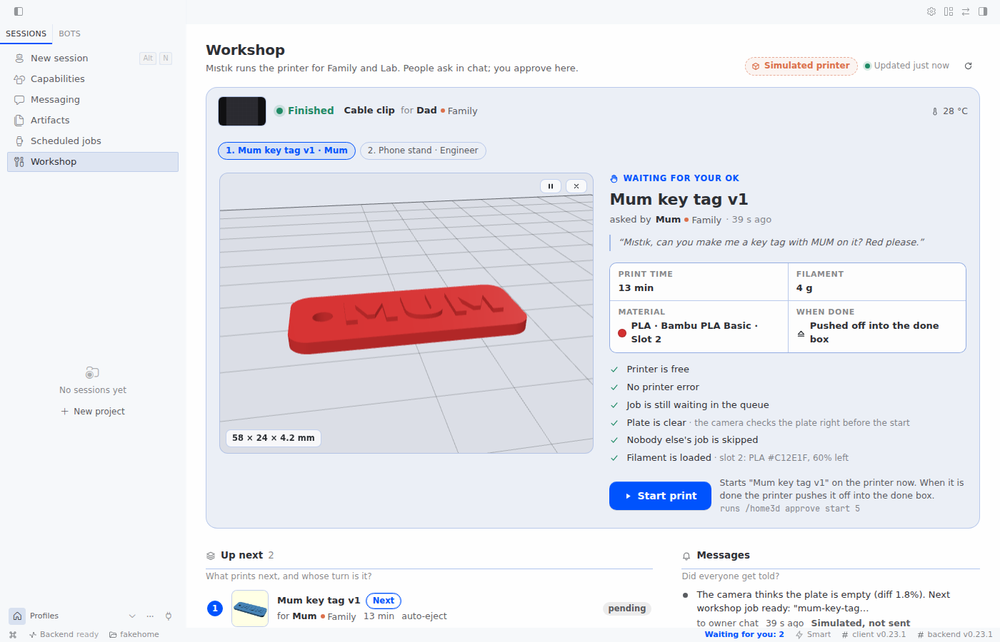

<!--
DRAFT pull request text for NousResearch/hermes-agent (the PR is already open at an older commit: update its
description with this text when the pin moves).
Title: plugin-catalog: add home-3d-workshop
Files: plugin-catalog/home-3d-workshop.yaml (copy docs/catalog/home-3d-workshop.yaml, drop its comment lines)
Before updating: replace <SHA40> everywhere (also in the entry's image and screenshots URLs), re-run validate at
that commit, check that every CI job (including the `openscad` job) is green on that commit, update "Status" with
the real-printer and Desktop results, and attach the demo video link. Remove this comment.
-->

# plugin-catalog: add home-3d-workshop

Adds one community entry: `plugin-catalog/home-3d-workshop.yaml`, pinned to
`Wijt/hermes-home-3d-workshop@<SHA40>` (version `0.2.0`, `requires_hermes: ">=0.22.5"`).

## What it does

**Ask. It's in the box.** The plugin makes a 3D printer a member of the group chat. A family (or a lab
team) shares one printer through one chat, where a Hermes agent lives; the persona is called Mıstık by
default, and the name and the message language (`en` by default, or `tr`) are settings. People ask in
plain words, often by voice note. The agent finds MakerWorld models through Bambuddy, scales one, or
designs a part in OpenSCAD (it writes the code, renders it, looks at the preview pictures and keeps every
version), slices it and queues it with manual start. The owner approves the start, typed, never by voice;
when someone else asks, the watcher passes the request to the owner with the exact command. A zero-token
cron watcher follows the print. On a tilted printer the part is pushed off into a done box, and the person
who asked is told with a photo, in the chat the request came from; the owner gets a technical note. Each
moment a person had to step in is logged. When one kind repeats, the plugin proposes an upgrade, for
example a printed tilted base for auto-eject.

People who ask never see a screen. The owner gets one screen in Hermes Desktop, **Workshop**: what is
printing and for whom, the part waiting for approval in 3D with its facts, a safety checklist and Start,
Pause and Stop, the queue with who asked and from which group, the done box, messages sent, pending and
failed, filament, where it needed a person and upgrade proposals, design versions in 3D, and a setup
check. Its backend routes are read-only; its buttons run the plugin's own `/home3d` command as the local
user, so the owner check stays in one place.

It comes from a real home: a Bambu Lab A1 managed by Bambuddy, used every day by a family through a
Hermes agent in their WhatsApp group. That agent once printed a tilted base for its own printer so
that finished parts slide off by themselves. The plugin turns that setup's lessons into tools, rules in
code, a watcher, a delivery outbox, a screen and two skills. The README tells the story.

It works with a Bambu Lab printer managed by Bambuddy, or with a built-in simulated printer. After
`hermes plugins install Wijt/hermes-home-3d-workshop --enable`, `hermes home3d demo` runs the whole
loop in about 10 seconds and sends nothing.

## Hermes surfaces used

- **Tools (14):** `home3d_status`, `home3d_camera`, `home3d_find_models`, `home3d_import`,
  `home3d_customize`, `home3d_design`, `home3d_slice`, `home3d_queue`, `home3d_start`, `home3d_stop`,
  `home3d_clear_plate`, `home3d_household`, `home3d_human_needed`, `home3d_upgrades`.
- **Hooks:** `pre_tool_call` (safety gates and owner approval for start, resume and plate-clear
  confirm; bounded: status and queue only, 5 s per request, 12 s in all), `post_tool_call` (audit
  trail), `pre_llm_call` (who is speaking, how the message arrived, short printer context),
  `pre_gateway_dispatch` (notes in memory that an inbound message is a voice note; always returns None).
- **Slash command:** `/home3d` (`status`, `approve start <id> [jump]`, `approve clear`,
  `approve resume [ack]`, `stop [reason]`, `pause [reason]`, `collected <part id>`, `whoami`, `upgrades`,
  `moments`, `help`).
- **CLI command:** `hermes home3d` (`setup`, `teardown`, `watch`, `status`, `doctor [--json]`, `simulate`,
  `demo`).
- **Skills:** `home-3d-workshop:household-printing` and `home-3d-workshop:parametric-design`.
- **Dashboard backend:** `dashboard/plugin_api.py`, three GET routes under
  `/api/plugins/home-3d-workshop/` (`health`, `overview`, `file`). `dashboard/dist/index.js` registers an
  empty placeholder; the manifest's tab is hidden.
- **Desktop half:** `desktop/plugin.js` (built from `src/` with esbuild; three.js 0.180.0 bundled, the
  only runtime dependency; imports only `@hermes/plugin-sdk`, `react` and `react/jsx-runtime`): a `/workshop` page with a
  sidebar entry, a status-bar chip, a palette command and, where the Desktop exports it, a tool-media card
  for `home3d_design`. Calls: `ctx.rest` to its own routes, gateway `session.create` and `slash.exec`
  (`/home3d ...` only), the composer, the clipboard and navigation.
- **Config:** `config_schema` only; one optional secret `HOME3D_BAMBUDDY_API_KEY`, read with
  `agent.secret_scope.get_secret`. No `requires_env`. Python standard library only.
- **Storage:** `plugin_data_dir` (SQLite and files under `HERMES_HOME/plugin-data/home-3d-workshop`).
- **Cron:** `hermes cron create --no-agent --script`, created by `hermes home3d setup`.

## Disclosure (rule 13)

- **Network.** Only the Bambuddy URL the user sets, over HTTP on the LAN. When set,
  `HOME3D_BAMBUDDY_API_KEY` is sent as `X-API-Key`, unencrypted over plain HTTP. MakerWorld lookups and
  downloads go through Bambuddy; the plugin makes no other network calls. The setup check (`hermes
  home3d doctor`, the status tool's `capabilities`, the Workshop screen) makes read-only requests,
  including `GET /api/v1/updates/version`, `GET /api/v1/makerworld/status` and
  `GET /api/v1/printers/<id>/camera/status`; it never takes a photo.
- **Printer and library writes.** Import, scale, design upload, slice and queue add write to the
  Bambuddy library and queue without a prompt, for the owner and the people in the household list
  (unknown senders only when `allow_guests` is on). Queue items are always manual start. Queue remove
  only removes the asking person's own waiting items: never a job queued outside the workshop or another
  household member's job, not even for the owner (who can remove anything by hand in Bambuddy). A tool
  photo or plate check switches the chamber light on for about 12 s, then restores its earlier state.
- **Chamber light from the cron job.** The watcher switches the light by itself for its plate checks
  and photos: at most once per pass (photo and check share one light cycle; twice when a camera request
  fails), one photo near the end of each print the workshop queued (other prints: one photo and plate
  check, in one light cycle, when they end), a check when a print ends, and re-checks that
  back off 15, 30, 60 and 120 min, at most 6, while a plate waits for a person or a job waits on an idle
  printer. The count starts again when the printer state, the job or the queue head changes.
- **Bambuddy settings.** Read with `GET /settings/`, never changed. With Bambuddy's
  `require_plate_clear` off, Bambuddy's own queue may start an auto-start item on a finished printer
  before the camera check. `hermes home3d doctor` warns about this when an auto-eject preset is set, and
  the README asks the user to turn the setting on.
- **Approvals (rule 12).** One rule (`gates.approval_refusal`) for the agent path, `/home3d` and the
  Workshop screen. Start, resume and plate-clear confirm are blocked in cron and in runs with nobody
  present (kanban workers, `chat -q`, `-z`, `--source tool`; one definition, fails closed), when a
  safety gate fails, for unknown or non-owner senders, and when the ask came in as a voice note (a typed
  confirmation is asked for). A household member's blocked request is stored, and the watcher tells the
  owner once, with the command; an unknown sender's is not passed on. Only an owner session gets the
  Hermes approve prompt. The handler also requires a single-use pass from that hook or from `/home3d
  approve`, so a dispatch that skips `pre_tool_call` is refused; it checks the plate with the camera
  right before the action. `/home3d approve` runs the gate and the action at once and stores nothing for
  later. The owner is any id in `owner_ids`, plus, while `local_is_owner` is true (the default), any local
  CLI, TUI or Desktop session and any slash command typed in the TUI, Desktop or web dashboard or run by
  the Workshop screen (these reach the plugin without a sender). The README asks users to turn
  `local_is_owner` off when others can reach the dashboard. On IRC and ntfy, where people choose their
  own ids, only an entry written with the platform (`irc:<nick>`) matches a sender. `yolo` and approvals
  off skip the prompt in an owner session; the unattended, identity and voice rules are blocks and are
  not skipped. Each `rule_key` is unique, so "always" does not carry over; each "always" answer still
  adds one unused `command_allowlist` line. Stop and pause need no approval and pass no gate; who may use
  them is `stop_policy` (`known`, the default: the owner and the household list; `anyone`; `owner`), and
  the person who did it is recorded and named to the owner.
- **Voice detection.** `pre_gateway_dispatch` reads each inbound gateway message's type and sender id,
  never its text, and keeps in memory only the kind and time of a sender's newest messages (at most 8,
  for 10 minutes, at most 500 senders; nothing for senders without a recent voice note). It always
  returns None, so dispatch is unchanged. `pre_llm_call` also treats a turn whose text has the shape of a
  Hermes transcript as voice. Local CLI, TUI and Desktop turns are not seen by the gateway hook, and a
  restart forgets the notes. Covered by tests with event objects shaped like Hermes'; not yet checked
  with a real voice note.
- **Workshop routes.** Three GET routes, mounted only while the plugin is enabled in `config.yaml`,
  callable by anyone who can use that Hermes's dashboard or API. `overview` returns printer state, queue,
  requesters' names and words, groups, the done box, filament, moments, upgrades, design versions and the
  setup check. Notice texts, send errors and setup details are left out while `local_is_owner` is off;
  chat targets are never included. Each call reads printer status and queue, never the camera; the setup
  check (read-only Bambuddy requests and `hermes cron list`) runs in a background thread at most once
  every 5 minutes. `file` returns only STL and image files from the plugin's `designs/` and `media/` folders (no
  absolute paths, no `..`, a suffix allowlist and a size cap). No route starts, stops, queues or writes
  anything.
- **Desktop bundle.** `desktop/plugin.js` runs in Hermes Desktop with the app's authority once the user
  turns it on in Capabilities → Plugins (off by default). Besides its own routes, it calls gateway
  `session.create` once, for one hidden session titled "Workshop actions (home-3d-workshop)", and
  `slash.exec` with `/home3d ...` commands only (other text is refused before sending), so every printer
  action goes through the plugin's own owner check as the local user. It polls `overview` every 15 s for
  the status-bar chip and every 5 s while the page is open. three.js is bundled; no remote code is loaded.
- **Hook time (rule 12).** Hermes 0.22.5 runs a hook callback with a 30 s timeout, and a timed-out
  `pre_tool_call` blocks every tool call of the process for 60 s, stop included. So `pre_tool_call`
  never uses the camera or the chamber light. It reads only printer status and queue, at most 5 s per
  request and 12 s in all, and blocks the gated call when the printer does not answer in time. It never
  issues a pass after that deadline. With a lower `plugins.hook_callback_timeout` the deadline is 0.4 of
  it, and `hermes home3d doctor` warns below 15 s.
- **Hermes internals (rule 9).** The plugin registers only through public `ctx.register_*` surfaces and
  patches nothing. To find cron and unattended runs it uses `ctx.current_cron_execution()` and also
  reads non-public Hermes internals: `gateway.session_context.get_session_env` (also for
  `HERMES_SESSION_CHAT_ID`, the chat a request came from), `cron.execution_identity._CURRENT` and
  `gateway.session_finite` (`finite_turn_required`, `unattended_turn`), and
  `hermes_cli.plugins._resolve_hook_callback_timeout` to size the hook deadline. It takes them from
  `sys.modules`, never imports them, and never writes to them, so `hermes plugins validate` does not
  list them. A check that raises counts as cron or unattended (fail closed). If a later Hermes renames
  one, that extra check is skipped; the public cron check and Hermes' own approval gate stay. A public
  "unattended run" seam in Hermes would let the plugin drop these reads.
- **Subprocesses.** `hermes send` (notices; `-p <send_profile>` when set; each stopped after
  `send_timeout_s`, default 20 s, and all sends of one pass within `send_budget_s`, default 45 s),
  `hermes cron create`, `list` and `remove` (setup and teardown; `list` also for the setup check),
  `openscad` (the templates and the agent's designs; `openscad --version` for the setup check) and
  `xvfb-run` (design preview pictures without a display), only when installed. Renders run one at a time,
  with a 180 s default time limit (at most 600 s) that stops the process group, a CPU-time limit (an
  orphaned OpenSCAD still stops), a memory cap and an STL size cap, without `OPENSCADPATH`. A design may
  read files only from its own folder and OpenSCAD's own libraries: the source is checked before the
  render, and OpenSCAD's `-d` list of the files it read is checked after it (a version that read anything
  else is refused: no STL, no pictures, no echo).
- **Background job and delivery.** One `--no-agent --script` cron job, every 2 minutes by default (720
  runs a day). It runs while the Hermes scheduler runs (`hermes gateway`). No model calls; empty output
  sends nothing. The script lives at `HERMES_HOME/scripts/home3d_watch.py`. It reads the plugin settings
  from `HERMES_HOME/config.yaml` on each pass and stays silent while the plugin is disabled or removed.
  `hermes home3d teardown` removes the job and the script; `setup --print-only` writes nothing. Every
  notice is saved in an outbox before it is sent (`pending`, `sent`, `failed`, `no_target`, `dry_run`). A
  failed send is retried on later passes (backoff from 1 min to 4 h, at most 10 attempts within 24 h);
  then the owner is told once. An event counts as told only after a real send.
- **Files and personal data.** Kept locally under `HERMES_HOME/plugin-data/home-3d-workshop`: SQLite
  (requests with the platform and chat id they came from, jobs, household and group sender ids and
  names, approval requests, who stopped or paused a print, the outbox with every notice and its delivery
  state, done-box records with who a part is for and who picked it up, open human-needed moments, audit
  events), `outbox.jsonl` (every send attempt), camera photos, model files, `designs/` (OpenSCAD source,
  STL, preview pictures and facts for every version), a watcher log and a settings snapshot without
  secrets (the watcher's fallback when it cannot read `config.yaml`).
- **Prompt context.** `pre_llm_call` adds up to 900 characters: for household members and the local
  owner on the first turn, on printing turns and on printer state changes, else one speaker line; for
  other senders only on printing turns. `inject_context: never` turns it off. While the plugin is
  enabled, its two skills add one line each to the skills index of every session.

## Validation and testing

- `HERMES_HOME=$(mktemp -d) hermes plugins validate <checkout at <SHA40>> --install-deps` on Hermes
  0.22.5: <!-- paste the final output at <SHA40> -->
- The pytest suite (more than 900 tests, no Hermes needed) runs in the repo CI, plus a job that runs
  `hermes plugins validate` against Hermes 0.22.5, and a job that installs `openscad` and `xvfb` on
  ubuntu-24.04 and runs the real-OpenSCAD tests with OpenSCAD 2021.01: the templates, a sample design and
  the file-access probes (each refused). <!-- confirm this job is green on <SHA40> --> The dashboard route
  tests need FastAPI and are skipped in CI; the Desktop half's tests run with Node (`npm test`), not in
  CI.
- `hermes home3d demo` runs the full loop on the simulator. Scripted stand-ins are marked `[staged]`.
- The Workshop screen was run in an isolated Hermes 0.23.1 (headless gateway and Webapp) on the simulated
  printer at this commit: Start, Pause, Resume, Stop and "Picked up" were pressed on the screen, and the
  simulated printer and the done box followed each time. It has not been run in the Hermes Desktop app.

## Status on real hardware

This matches the README's status table at the same commit. Nothing new in 0.2.0 was run on the real
printer.

- Verified on a real Bambuddy 1.3.0 with an A1: printer status, queue, plate check, the lit photo with
  plate check in one light cycle (light restored to its earlier state), MakerWorld cards and import,
  slice with the auto-eject preset (G-code check), scale, queue add with manual start and remove, and
  reading `require_plate_clear` and the queue history (GET only).
- The watcher in dry run (outbox only) on a real family print it did not queue: no light or camera
  during the print, FINISH caught, one light cycle for the photo and plate check, one owner notice. The
  A1's auto-eject order (RUNNING through the cool-down and the push, then FINISH) was seen on that print.
- Designing: the templates, a sample design and the file-access probes are tested with OpenSCAD
  2021.01 (locally and in the CI `openscad` job). On the real Bambuddy, a pen cup with a name was
  designed with `home3d_design` in three versions, uploaded to the library and sliced with the
  auto-eject preset.
- Tests only (not on the real printer): the outbox and its retries, groups and routing by origin chat,
  the done box, voice detection, `stop_policy`, `allow_guests`, the setup check and its new Bambuddy GET
  requests, and the Workshop routes.
- Planned on the real printer: start, stop, pause, resume and plate-clear confirm, watcher notices
  sent with `hermes send`, the auto-eject push with this plugin (the push itself is real in the
  original setup), and the Workshop screen against a real printer.
  <!-- update before updating the PR -->

## Screenshots

From the Hermes 0.23.1 run on the simulated printer:

- https://raw.githubusercontent.com/Wijt/hermes-home-3d-workshop/<SHA40>/docs/screenshots/workshop-approve-light.png
- https://raw.githubusercontent.com/Wijt/hermes-home-3d-workshop/<SHA40>/docs/screenshots/workshop-printing-light.png
- https://raw.githubusercontent.com/Wijt/hermes-home-3d-workshop/<SHA40>/docs/screenshots/workshop-done-and-health.png
- https://raw.githubusercontent.com/Wijt/hermes-home-3d-workshop/<SHA40>/docs/screenshots/workshop-approve-dark.png

## Links

- Repo and README: https://github.com/Wijt/hermes-home-3d-workshop/tree/<SHA40>
- Demo video (under 90 s): <!-- X post link -->

## Checklist

- [x] One file, `plugin-catalog/home-3d-workshop.yaml`
- [x] `sha` is a full 40-character commit; `version` is quoted and matches `plugin.yaml`
- [x] `requires_hermes` is `">=0.22.5"` in the entry and in `plugin.yaml`
- [x] Declared tools and hooks match what the plugin registers
- [x] `image` and `screenshots` are pinned to the entry's commit
- [x] Secrets only through `get_secret`; no `.env` reads; no binaries or `.pyc` files
- [x] No self-updating code; no monkey-patching; registers only through public `ctx.register_*`
  surfaces (the read-only use of non-public Hermes internals is disclosed above)
- [x] The Desktop half imports only `@hermes/plugin-sdk`, `react` and `react/jsx-runtime`; three.js is bundled
- [x] Disclosures are in the README and in the entry description
- [x] I am the plugin's author and maintainer

🤖 Generated with [Claude Code](https://claude.com/claude-code)
